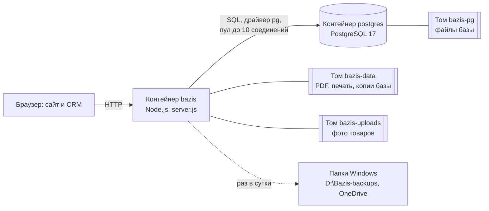
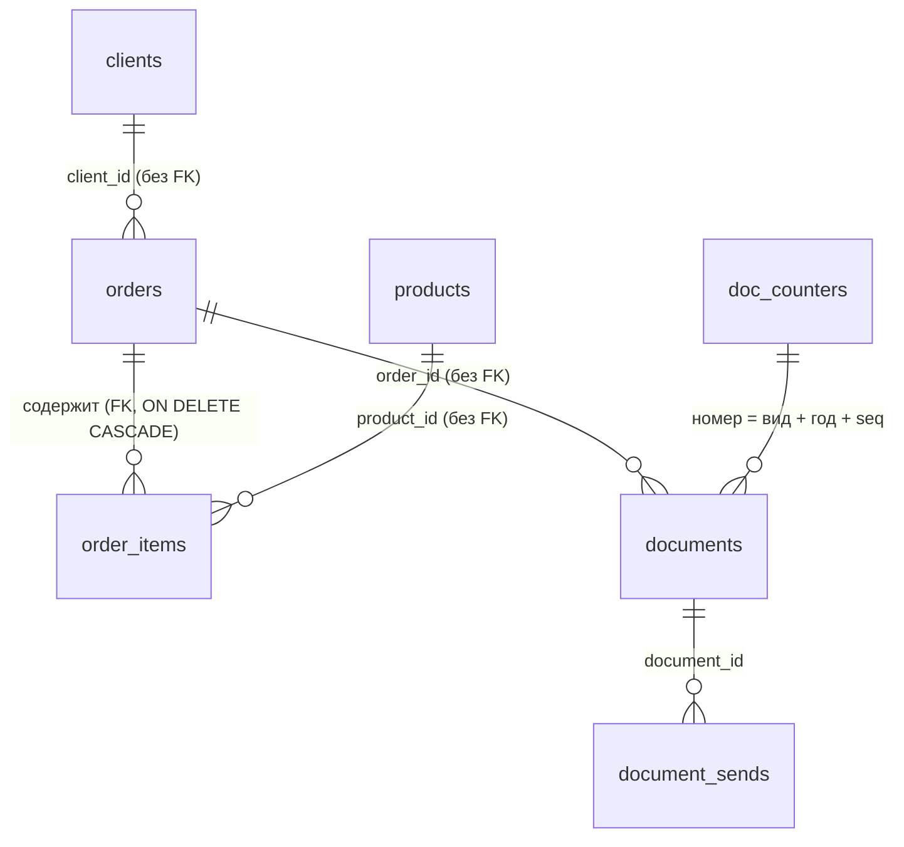

# Отчёт: хранение данных и использование PostgreSQL в проекте «Базис»

*Состояние на 10 октября 2026 г.*

## 1. Кратко

«Базис» — сайт компании с CRM (учёт заказов, клиентов, каталога, счетов и актов). Сервер написан на Node.js, интерфейс — на React.

До октября 2026 года данные хранились в файле SQLite (`data/bazis.db`). Теперь все структурированные данные хранятся в **PostgreSQL 17**. Сервер базы работает в отдельном контейнере Docker рядом с контейнером сайта. Старые данные (9 заказов, 11 позиций заказов, 4 клиента, 13 товаров, 1 счёт) перенесены автоматически. Перенос проверен построчно: все записи и все поля совпали.

Почему PostgreSQL, а не SQLite:

- настоящий сервер БД: к нему можно подключаться одновременно из сайта, из служебных скриптов и из клиентов вроде pgAdmin или DBeaver;
- строгие ограничения целостности (`CHECK`, `PRIMARY KEY`, `FOREIGN KEY`, `UNIQUE`) и типы данных;
- полноценные транзакции с уровнями изоляции и блокировками;
- стандарт для серверных приложений: проект можно перенести на любой хостинг с PostgreSQL.

## 2. Общая схема



## 3. Что и где хранится

| Данные | Где хранятся |
|---|---|
| Товары, клиенты, заказы, позиции, счета и акты, счётчики номеров, настройки и реквизиты компании, журнал отправки документов | PostgreSQL, том Docker `project_bazis-pg` |
| PDF выпущенных документов, изображения печати и подписи | Файлы, том `project_bazis-data` |
| Фотографии товаров | Файлы, том `project_bazis-uploads` |
| Ежедневные копии базы (14 последних) | Файлы `bazis-ГГГГ-ММ-ДД.json.gz`, том `project_bazis-data` |
| Внешние копии (30 последних) | Папки `D:\Bazis-backups` и OneDrive |
| Старый файл SQLite (не удалён, не используется) | `data/legacy-sqlite/<время>/bazis.db` в томе данных |

В базе лежат только структурированные данные. Большие двоичные файлы (PDF, картинки) хранятся на диске, а в базе — их имена. Это обычная практика: база остаётся маленькой, а копии делаются быстро.

## 4. Как развёрнут PostgreSQL

Сервер описан в `docker-compose.yml` как сервис `postgres`:

```yaml
postgres:
  image: postgres:17-alpine
  environment:
    POSTGRES_DB: bazis
    POSTGRES_USER: bazis
    POSTGRES_PASSWORD: ${POSTGRES_PASSWORD}   # из файла .env, в git не попадает
  ports:
    - "127.0.0.1:5432:5432"                  # доступ только с этого компьютера
  volumes:
    - bazis-pg:/var/lib/postgresql/data       # данные переживают пересоздание контейнера
  healthcheck:
    test: ["CMD-SHELL", "pg_isready -U bazis -d bazis"]
```

Как это устроено:

- **Сохранность данных.** Файлы базы лежат в именованном томе Docker. Контейнер можно удалить и создать заново (например, при обновлении), данные останутся.
- **Порядок запуска.** Сайт стартует только после того, как база ответила на проверку `pg_isready` (`depends_on: condition: service_healthy`).
- **Безопасность.** Порт открыт только на `127.0.0.1`: из интернета к базе подключиться нельзя. Пароль задан в `.env`, файл исключён из git и из образа Docker.
- **Подключение сайта.** Адрес задаётся одной строкой `DATABASE_URL=postgres://bazis:<пароль>@postgres:5432/bazis`.

## 5. Структура базы

### 5.1. Таблицы и связи



| Таблица | Назначение | Ключ |
|---|---|---|
| `products` | Каталог: название (рус./каз.), цена, валюта, вид (товар/услуга), остаток | `id` |
| `clients` | Карточки клиентов, нормализованный телефон для поиска, реквизиты (JSON) | `id` |
| `orders` | Заказы и заявки: канал, статус, покупатель, скидка, доставка, НДС | `id` |
| `order_items` | Позиции заказа: количество, цена, сколько штук зарезервировано и выдано | `(order_id, position)` |
| `doc_counters` | Последний выданный номер документа по виду и году | `(kind, year)` |
| `documents` | Счета и акты; `snapshot` — все данные на момент выпуска | `id`, `UNIQUE (kind, year, seq)` |
| `document_sends` | Журнал отправки документов по e-mail и в Telegram | `id` (IDENTITY) |
| `settings` | Настройки и реквизиты компании (ключ — значение) | `key` |
| `schema_meta` | Версия схемы базы | `id = 1` |

Почему у части связей нет внешнего ключа — это решения предметной области:

- карточку клиента можно удалить, а его заказы должны остаться;
- выпущенный счёт — бухгалтерский документ, он остаётся даже после удаления заказа.

Позиции заказа, наоборот, без заказа не существуют. Поэтому у них внешний ключ с каскадным удалением.

### 5.2. Ограничения целостности

Неверные данные отвергает сама база, а не только код сайта:

```sql
price    DOUBLE PRECISION NOT NULL DEFAULT 0 CHECK (price >= 0),
currency TEXT NOT NULL DEFAULT 'KZT' CHECK (currency IN ('KZT', 'RUB', 'USD')),
stock    INTEGER CHECK (stock IS NULL OR stock >= 0),          -- NULL = остаток не учитывается
vat_rate DOUBLE PRECISION NOT NULL DEFAULT 0 CHECK (vat_rate >= 0 AND vat_rate < 100),
status   TEXT NOT NULL DEFAULT 'active' CHECK (status IN ('active', 'annulled')),
UNIQUE (kind, year, seq)                                       -- номер документа не повторится
```

На проверке это сработало. Копию с отрицательной ценой товара PostgreSQL отказался загружать (`products_price_check`), и восстановление откатилось целиком.

### 5.3. Индексы

Индексы созданы под реальные запросы CRM:

- `orders (created_at, id)` и `orders (status, created_at, id)` — список заказов, новые сверху, с фильтром по статусу;
- `orders (channel, status, created_at, id)` — вкладки «Заказы» и «Заявки»;
- `clients (phone_key)` — поиск клиента по телефону при оформлении заказа;
- `order_items (product_id)` — подсчёт зарезервированного товара;
- `documents (order_id, kind, currency, status)` — документы заказа.

### 5.4. Собственные функции SQL

В схеме объявлены три функции на языке SQL:

```sql
-- поиск без учёта регистра и буквы «ё», включая казахские буквы
CREATE FUNCTION bz_fold(value TEXT) RETURNS TEXT LANGUAGE sql IMMUTABLE ...
-- только цифры телефона: «+7 701 000-00-01» → «77010000001»
CREATE FUNCTION bz_digits(value TEXT) RETURNS TEXT LANGUAGE sql IMMUTABLE ...
-- поле из JSON; повреждённый JSON даёт NULL, а не ошибку всего запроса
CREATE FUNCTION bz_json_field(value TEXT, field TEXT) RETURNS TEXT LANGUAGE sql STABLE ...
```

## 6. Как сайт работает с базой

Весь код работы с базой собран в папке `db/`:

| Файл | Что делает |
|---|---|
| `connection.js` | Подключение по `DATABASE_URL`, пул соединений, ожидание запуска базы, тайм-ауты |
| `schema.js` | Схема (`CREATE TABLE …`), версия схемы, будущие обновления |
| `store.js` | Все запросы сайта: товары, заказы, клиенты, документы |
| `dump.js` | Резервная копия в файл и восстановление |
| `sqlite-import.js` | Разовый перенос из старой базы SQLite |

Остальной код сайта не пишет SQL сам, а вызывает методы хранилища: `store.orders.insert(...)`, `store.clients.list()` и т. д. Все запросы параметризованы (значения передаются отдельно от текста запроса), поэтому SQL-инъекция невозможна.

### 6.1. Транзакции

Связанные изменения выполняются одной транзакцией: применяются целиком или не применяются вовсе. Пример — оформление заказа: запись заказа, позиции, списание остатков и привязка к карточке клиента.

```js
return tx(async () => {
  await insertOrderRow(order);        // заказ и позиции
  await reserveStock(order.id);       // списание остатков; при нехватке — исключение
  return orders.get(order.id);
});                                   // исключение → ROLLBACK, ничего не сохранится
```

Внутри `tx` выполняется `BEGIN … COMMIT`, а при любой ошибке — `ROLLBACK`.

### 6.2. Одновременные запросы

Два покупателя могут одновременно заказать последний экземпляр товара, а менеджер — дважды нажать «Выпустить счёт». Для таких случаев применены три приёма.

**1. Очередь пишущих транзакций.** Каждая пишущая транзакция первой командой берёт рекомендательную блокировку PostgreSQL. Блокировка снимается автоматически при `COMMIT` или `ROLLBACK`:

```sql
SELECT pg_advisory_xact_lock(4242001);
```

**2. Проверка и изменение одним запросом.** Остаток списывается, только если его хватает. Отдельного шага «прочитать, затем записать» нет:

```sql
UPDATE products SET stock = stock - $1
WHERE id = $2 AND stock IS NOT NULL AND stock >= $1;
-- 0 изменённых строк = товара не хватает → заказ отклоняется
```

**3. Атомарная выдача номера документа** через `INSERT … ON CONFLICT … RETURNING`:

```sql
INSERT INTO doc_counters (kind, year, last) VALUES ($1, $2, 1)
ON CONFLICT (kind, year) DO UPDATE SET last = doc_counters.last + 1
RETURNING last;
```

**Согласованное чтение.** Когда нужно прочитать несколько таблиц сразу (заказ и его позиции), используется транзакция
`BEGIN ISOLATION LEVEL REPEATABLE READ READ ONLY`: все запросы видят базу в один и тот же момент.

Всё это проверено тестами. 8 одновременных заказов на ограниченный остаток не уводят его в минус. 6 параллельных выпусков документов дают 6 разных номеров подряд. Двойное нажатие выпускает один счёт.

### 6.3. Постраничный вывод заказов

Список заказов разбит на страницы по 50 записей. Используется не `OFFSET`, а курсор по последней показанной записи (keyset pagination). Такой способ не замедляется на дальних страницах и не пропускает и не повторяет записи, если в это время добавился новый заказ:

```sql
SELECT * FROM orders
WHERE channel <> 'site' AND (created_at, id) < ($1::text, $2::text)
ORDER BY created_at DESC, id DESC
LIMIT 51;            -- на одну больше: есть ли следующая страница
```

Позиции всех заказов страницы загружаются одним запросом `WHERE order_id = ANY($1::text[])`, а не отдельным запросом на каждый заказ.

### 6.4. Надёжность подключения

| Ситуация | Что происходит |
|---|---|
| База ещё запускается | Сервер ждёт её до 60 секунд; запросы к API получают ответ 503 «Сервер запускается» |
| Связь с базой пропала во время работы | Ответ 503 `db_unavailable`, оповещение владельцу в Telegram; когда база вернётся, сайт продолжит работу сам |
| Запрос завис | `statement_timeout = 60 с`: PostgreSQL прервёт запрос |
| Транзакция брошена незавершённой | `idle_in_transaction_session_timeout = 60 с`: блокировка не держится вечно |
| Проверка здоровья | `GET /api/health` выполняет `SELECT 1` с тайм-аутом 3 с; Docker видит «healthy» или «unhealthy» |
| Старая версия PostgreSQL | Сервер требует версию 16 или новее и прямо сообщает, если версия ниже |

### 6.5. Версии схемы

Номер версии схемы хранится в таблице `schema_meta`. Если новой версии сайта нужна другая структура, при запуске сервер:

1. сохраняет копию базы `bazis-before-v<N>-<время>.json.gz`;
2. выполняет все обновления схемы одной транзакцией;
3. записывает новый номер версии.

Если сайт видит базу более новой версии, чем он сам, он не запускается и просит обновиться. Так старая версия не испортит данные.

## 7. Перенос данных из SQLite

Перенос выполнился автоматически при первом запуске новой версии на пустом PostgreSQL:

1. в одной транзакции создаётся схема и копируются все таблицы из `bazis.db`;
2. число записей в каждой таблице сверяется с исходным;
3. при любой ошибке транзакция откатывается: PostgreSQL остаётся пустым, файл SQLite — на месте;
4. после успеха файл SQLite не удаляется, а перемещается в `data/legacy-sqlite/<время>/`.

Как это было проведено на рабочем сайте:

1. **Резервные копии:** архивы томов Docker, согласованная копия SQLite с проверкой целостности (`PRAGMA integrity_check = ok`) и внешняя копия.
2. **Репетиция** на копии рабочих данных во временных контейнерах.
3. **Перенос:** `docker compose up -d --build`. Запись в журнале: `Перенос из SQLite (схема 4) в PostgreSQL: товаров 13, клиентов 4, заказов 9, документов 1`.
4. **Сверка:**
   - по идентификаторам: 13 старых копий SQLite и JSON-файлы первой версии. Записей, которых нет в PostgreSQL, не найдено;
   - по значениям: каждое поле каждой строки всех таблиц. Различий — 0.

## 8. Резервное копирование

| Уровень | Когда | Где | Формат |
|---|---|---|---|
| Ежедневная копия | При запуске и раз в сутки, хранится 14 | Том `bazis-data/backups` | `bazis-ГГГГ-ММ-ДД.json.gz` |
| Перед обновлением схемы | Автоматически | Там же | `bazis-before-v<N>-….json.gz` |
| Внешняя копия | Ежедневно в 03:00 (планировщик Windows), хранится 30 | `D:\Bazis-backups`, OneDrive | Папка: `database.json.gz` + PDF + картинки + `manifest.json` с SHA-256 каждого файла |
| Вручную | По команде | Куда укажете | `npm run db:dump` |

Копия базы делается в транзакции `REPEATABLE READ`: снимок согласован, хотя сайт в это время работает. Восстановление (`npm run db:restore` или `restore-backup.bat`) выполняется так:

- все таблицы заменяются одной транзакцией: либо копия загружена полностью, либо база не тронута;
- текущие данные перед этим сохраняются;
- если восстановление не удалось, прежние данные возвращаются автоматически.

Все сценарии восстановления проверены на изолированной копии проекта:

- из копии времён SQLite;
- из копии формата PostgreSQL;
- из намеренно испорченной копии: восстановление откатилось, прежние данные вернулись.

## 9. Тестирование

- **Без отдельного сервера.** Тесты работают на PGlite — это тот же PostgreSQL, собранный в WebAssembly и запускаемый внутри процесса Node.js.
- **На настоящем сервере.** Те же тесты запускаются на PostgreSQL 17 через переменную `BAZIS_TEST_DATABASE_URL`.
- **Итог.** 259 серверных тестов и 52 теста интерфейса проходят; 58 тестов базы проходят на настоящем PostgreSQL 17.
- **При сборке.** Образ Docker не соберётся, если хотя бы один тест упал, поэтому код с ошибкой не попадёт на рабочий сайт.
- **Сквозная проверка** (`scripts/docker-e2e.ps1`, 19 проверок): заказ, PDF, перезапуск сайта, пересоздание контейнера, перезапуск PostgreSQL без перезапуска сайта.

## 10. Как посмотреть данные самому

Через консоль PostgreSQL в контейнере:

```powershell
docker compose exec postgres psql -U bazis -d bazis
```

Примеры запросов:

```sql
\dt                                                  -- список таблиц
\d orders                                            -- структура таблицы заказов
SELECT status, COUNT(*) FROM orders GROUP BY status; -- заказы по статусам
SELECT o.created_at, o.customer_name, i.title, i.qty, i.price
FROM orders o JOIN order_items i ON i.order_id = o.id
ORDER BY o.created_at DESC LIMIT 10;                 -- последние позиции заказов
SELECT number, kind, total FROM documents;           -- выпущенные документы
```

Число записей во всех таблицах: `npm run db:counts`. Подключиться графическим клиентом (pgAdmin, DBeaver) можно по адресу `127.0.0.1:5432`, база `bazis`, пользователь `bazis`, пароль — `POSTGRES_PASSWORD` из `.env`.

## 11. Ограничения и что можно улучшить

- Режим запуска без Docker тоже использует PostgreSQL из Docker, поэтому Docker Desktop должен запускаться при входе в Windows.
- Даты хранятся текстом в формате ISO 8601 (UTC), как было в SQLite. Они правильно сравниваются и сортируются как строки. Перевод на тип `timestamptz` — возможное улучшение.
- Суммы хранятся как `DOUBLE PRECISION`. Для денег правильнее тип `NUMERIC`, это кандидат на следующее обновление схемы.
- Дополнительные поля заказов и реквизиты хранятся как JSON в текстовом поле. Можно перевести на тип `jsonb` с индексами, если по ним понадобится искать.
